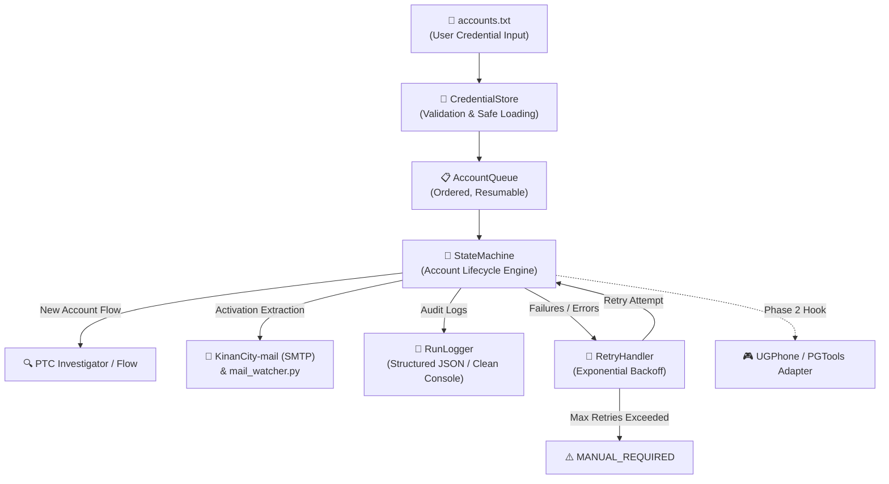
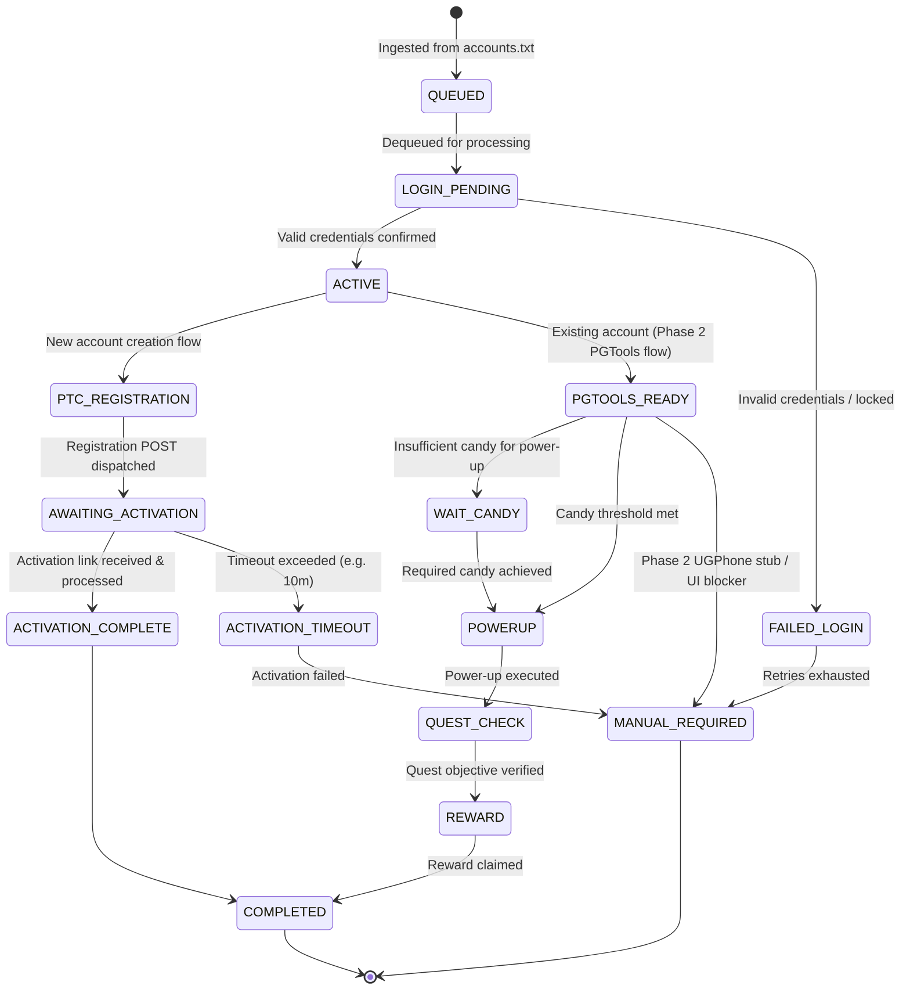

# KinanCity & Automation Backend — Architecture Specification

**Project:** KinanCity Modernization & Account Automation System  
**Branch:** `modernization/build-restore`  
**Date:** October 2026  

---

## 1. System Overview

The modernized system consists of two primary layers:
1. **The Legacy KinanCity Java Platform (Restored):**
   - Multi-module Maven project running on Java 17.
   - Restored build, clean dependency tree (resolved duplicate OkHttp library conflicts).
   - `KinanCity-mail` SMTP email listener and activation link extractor with fixed single-part/multipart MIME handling.
   - Hardened logging to prevent plain-text credential leaks.
2. **The Python Automation Backend (`python-automation/`):**
   - Resumable, editable account queue (`accounts.txt` + `queue_state.json`).
   - Finite State Machine tracking the complete lifecycle of accounts.
   - PTC registration flow investigator and diagnostics.
   - `mail_watcher.py` bridging the SMTP activation log to account state transitions.
   - Exponential backoff retry handler and audit-ready structured logging without secret leaks.
   - Adapter stub ready for Phase 2 UGPhone / PGTools cloud mobile automation.



---

## 2. Java Subsystem Architecture

The Java repository is organised as a multi-module Maven build with the following active modules:

| Module | Responsibility | Key Modernization Updates |
|---|---|---|
| `ptc-api` | PTC HTTP client, session handling, cookie management | Redacted passwords from session logging; updated OkHttp dependencies |
| `KinanCity-core` | CLI runner, batch registration orchestration, proxy manager | Fixed OkHttp runtime conflicts, redacted password prints |
| `KinanCity-mail` | Embedded SubEthaSMTP receiver, MIME parser, regex link extractor | Fixed single-part text parsing and regex URL extraction |
| `KinanCity-captcha-api` | Captcha provider abstraction interfaces | Maintained compatibility |
| `KinanCity-captcha-*` | Integrations (2captcha, AntiCaptcha, CapSolver, etc.) | Retained for CAPTCHA solver provider calls |
| `KinanCity-utils` | Shared helper classes and string utilities | Java 17 compile fixes |

---

## 3. Python Automation Backend Architecture

### 3.1 Component Architecture

```
python-automation/
├── accounts.txt            # User credential input (username:password) [Git-ignored]
├── queue_state.json        # Persistent account state machine tracking [Git-ignored]
├── config.ini              # System configuration (timeouts, retry limits, paths)
├── account_record.py       # AccountRecord data model and AccountState enum
├── account_queue.py        # Queue manager, accounts.txt loader, state sync
├── credential_store.py     # Safe credential ingestion and format validation
├── state_machine.py        # Finite state engine directing account transitions
├── retry_handler.py        # Exponential backoff and retry limiter
├── ptc_investigator.py     # Read-only probe of live PTC sign-up endpoints
├── mail_watcher.py         # Subprocess bridge to KinanCity-mail links.log
├── run_logger.py           # Structured JSON logger with secret redaction
└── adapters/
    └── ugphone_adapter.py  # Abstraction layer for UGPhone / PGTools integration
```

### 3.2 State Machine Specification



---

## 4. Security & Privacy Boundary

1. **Zero Secret Logging:**
   - Passwords and raw authentication tokens are excluded from all logging streams (`run_logger.py`, standard output, and log files).
   - `queue_state.json` saves only metadata (`username`, `state`, `retries`, `timestamps`, `last_error`). Passwords are never written to disk by the state machine; they remain strictly in the user-provided `accounts.txt`.
2. **Safe Error Messages:**
   - Error messages sanitized before assignment to `last_error` or `notes`.
3. **Audit Trail:**
   - Execution logs are saved as structured JSON lines (`logs/run_*.jsonl`) enabling automated parsing and monitoring.

---

## 5. Phase 2 UGPhone / PGTools Integration Hook

The `UGPhoneAdapter` in `adapters/ugphone_adapter.py` defines the contract for controlling cloud Android devices running PGTools:
- Device allocation & cloud phone power state management.
- PGTools app launching and Pokémon GO process monitoring.
- In-game state checks (Candy quantity, power-up confirmation, quest progress).
- Account switching and credential handover.
