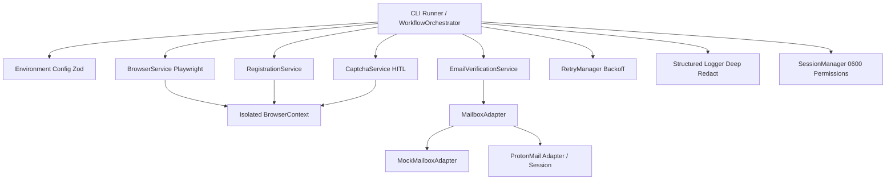

# KinanCity Playwright Automation Architecture

## 1. System Overview

The modernized **KinanCity Playwright Framework** is a modular, high-reliability TypeScript automation architecture designed for authorized account workflow validation, testing, and lifecycle monitoring.



---

## 2. Component Design & Responsibilities

### 2.1 Configuration Layer (`src/config/environment.ts`)
- **Runtime Validation:** Enforces strict environment schemas using `Zod`.
- **Security Boundaries:** Rejects execution against production domains unless `ALLOW_PRODUCTION_REGISTRATION=true` is explicitly provided.
- **Origin Allowlists:** Enforces `ALLOWED_ORIGINS` to prevent Server-Side Request Forgery (SSRF) and malicious redirects.
- **Zero Credential Exposure:** Scrubbing passwords from schema error messages before emission.

### 2.2 Browser Service (`src/core/browser.service.ts`)
- **Standard Playwright APIs:** Drives Chromium instances using official Playwright bindings.
- **Context Isolation:** Every execution context is strictly isolated to prevent cookie or state leakage.
- **Lifecycle Management:** Auto-registers `SIGINT` and `SIGTERM` handlers for graceful resource teardown.
- **Diagnostic Capture:** Automatically saves screenshots to `logs/screenshots/` and trace bundles to `logs/traces/` on failure.

### 2.3 CAPTCHA Challenge & Human-in-the-Loop (`src/services/captcha.service.ts`)
- **Vendor Detection:** Detects reCAPTCHA v2/v3, Cloudflare Turnstile, and hCaptcha across main frames and child iframes.
- **Active vs Completed Classification:** Evaluates token presence rather than assuming visual presence indicates a solved challenge.
- **HITL Verification:** Pauses execution with bounded operator timeouts (`OPERATOR_TIMEOUT_MS`) to allow authorized human interaction.
- **Strict Compliance:** Zero anti-bot evasion techniques or illegal CAPTCHA bypass mechanisms.

### 2.4 Mailbox Verification Adapter (`src/adapters/` & `src/services/email.service.ts`)
- **Pluggable Architecture:** Defined via `MailboxAdapter` interface.
- **Mock Implementation:** `MockMailboxAdapter` supports reproducible local test fixtures and CI pipelines.
- **Proton Mail Integration:** Supports authenticated storage state sessions via `src/scripts/initProtonSession.ts`.
- **SSRF Defense:** Verifies activation links against configured allowlists before navigation.
- **Freshness Filtering:** Ingests only emails arriving after workflow start timestamps (`sinceTimestamp`).

### 2.5 Workflow State Machine (`src/runner.ts`)
The execution follows an explicit, deterministic state machine:

```
[QUEUED] ──> [NAVIGATING] ──> [FILLING_CREDENTIALS] ──> [SUBMITTING]
                                                              │
[COMPLETED] <── [ACTIVATING] <── [AWAITING_EMAIL_VERIFICATION] ┘
     │
     └──> [FAILED] (Captured diagnostics & screenshot)
```

---

## 3. Storage & Session Security

- **Restricted Permissions:** All session state files (`sessions/*_storage_state.json`) are locked to POSIX `0600` (read/write for file owner only).
- **Directory Isolation:** The `sessions/` directory is created with `0700` permissions.
- **Path Traversal Defense:** Session names are scrubbed using `[^a-zA-Z0-9_-]` to prevent arbitrary directory escape.
- **Validation Engine:** Stored session files are validated against `StorageStateSchema` and expiration timestamps before reuse.
